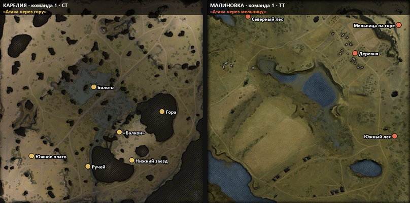

# Tactical Positions — ключевые позиции на миникарте для «Мира танков»

В начале боя мод отмечает на миникарте ключевые позиции для вашего класса техники и пишет
в чат боя название тактики и её описание.



## Откуда позиции

Позиции не придуманы: мод берёт официальную разметку из режима «Топография»
(`scripts/maps_training_tactical_maps.xml` в клиенте). Там для каждой карты, стороны и класса
техники разработчики отметили ключевые точки и описали тактику. Названия и описания
берутся из локализации клиента (`maps_training.mo`).

Поэтому есть ограничения:

- разметка есть для **14 карт**: Карелия, Малиновка, Провинция, Прохоровка, Энск, Лайв Окс,
  Руинберг, Рудники, Мюнхен, Песчаная река, Эль-Халлуф, Степи, Перевал, Линия Маннергейма;
- только для **тяжёлых и средних танков** — для ЛТ, ПТ и САУ в «Топографии» точек нет.

На остальных картах и классах мод ничего не показывает.

Мод показывает только заранее известные точки карты и ничего не знает о противниках
в текущем бою, так что под пункты [списка запрещённых модификаций](https://lesta.ru/support/ru/products/mt/article/15152/)
он не подпадает.

## Установка

Скачать `.mtmod` из [Releases](../../releases) и положить в `<папка игры>/mods/<версия клиента>/`.

## Как устроено

```
mod/scripts/client/gui/
  mods/mod_tactical_positions.py   точка входа
  tactical_positions/
    tactics.py                     разбор разметки, пересчёт координат (без зависимостей от клиента)
    minimap.py                     плагин миникарты и вывод в чат
tools/
  packed_xml.py                    чтение упакованного XML BigWorld
  preview.py                       рисует точки поверх миникарт из клиента
tests/
```

**Миникарта.** Боевая миникарта собирается из плагинов в `MinimapComponent._setupPlugins`.
Мод оборачивает этот метод и добавляет свой плагин, который в `start()` ставит метки.
Своих flash-ресурсов у мода нет: используется метка «точка навигации» — та же, что игрок
ставит через радиальное меню, она уже есть в `minimap.swf`.

**Координаты.** В «Топографии» точки заданы в пикселях миникарты лобби 570×570
(левый верхний угол иконки 12×12). Мод переводит их в координаты арены через
`boundingBox` карты, ось Y при этом переворачивается. Формулу удобно проверять
`tools/preview.py`: он делает обратный пересчёт и рисует точки на текстуре миникарты,
картинка выше сделана им.

## Разработка

```bash
python -m unittest discover -s tests          # тесты, Python 2.7 и 3
python tools/preview.py C:/Games/Tanki        # картинки в docs/preview/, нужен Pillow
PY27=C:/Python27/python.exe python build.py --install C:/Games/Tanki
```

## Лицензия

MIT. Разметка позиций и тексты принадлежат Lesta Games и в репозиторий не входят —
мод читает их из установленного клиента.
